<!-- animated contribution graph: real data, boxes reveal cell by cell
     (regenerated daily by .github/workflows/update-profile-art.yml) -->

<h3><code>prashant@github ~ $ ./contributions.sh</code></h3>

 
 

<!-- profile art (left) + streak/numbers card (right). both svgs are
     840x880 so equal widths give equal heights.
     art:      python scripts/make_ascii_svg.py
     stats:    python scripts/render_stats_svg.py (same daily workflow) -->

<h3><code>prashant@github ~ $ whoami</code></h3>

<table>
<tr>
<td valign="top"></td>
<td valign="top"></td>
</tr>
</table>

 
 

<h3><code>prashant@github ~ $ cat about-me.txt</code></h3>

I'm Prashant Lodhi, an aspiring Data Analyst and Business Intelligence Analyst focused on turning raw data into clear insights that support better business decisions.

<ul align="left">
  <li>M.Sc. in Biotechnology; bringing a research-oriented, evidence-first approach to analysis.</li>
  <li>Building interactive dashboards, exploring business KPIs, and communicating findings through data storytelling.</li>
  <li>Learning by building end-to-end projects across business intelligence, exploratory data analysis, and Python applications.</li>
</ul>

<h3><code>prashant@github ~ $ tech-stack --list</code></h3>

<h4>Data Analytics & Business Intelligence</h4>

<h4>Python & Data Analysis</h4>

<h4>Development & Databases</h4>

 

<h3><code>prashant@github ~ $ ls ./featured-projects</code></h3>

<table align="center">
<tr>
<td width="50%" valign="top">

<h4><a href="https://github.com/PrashantDes/Insurance-Performance-Analysis">Shield Insurance Performance Analysis</a></h4>

Power BI dashboard analyzing insurance revenue, customer acquisition, policy mix, sales channels, and age-group performance.

<ul align="left">
  <li>Built KPI-focused views for portfolio, sales channels, customer demographics, and expected settlement exposure.</li>
  <li>Identified that offline agents contributed 50.85% of revenue, while digital channels together contributed about 38%.</li>
  <li>Tools: Power BI, DAX, data modeling, data visualization.</li>
</ul>

</td>
<td width="50%" valign="top">

<h4><a href="https://github.com/PrashantDes/business-insight-360">Business Insights 360</a></h4>

Interactive business intelligence dashboards spanning Finance, Sales, Marketing, Supply Chain, and Executive reporting.

<ul align="left">
  <li>Analyzed net sales, gross margin, net profit, market performance, and forecast accuracy.</li>
  <li>Connected operational and financial metrics to show why sales growth alone does not guarantee profitability.</li>
  <li>Tools: Power BI, Power Query, DAX, data modeling.</li>
</ul>

</td>
</tr>
<tr>
<td width="50%" valign="top">

<h4><a href="https://github.com/PrashantDes/WaveCon_5G_Impact_Analysis">WaveCon 5G Impact Analysis</a></h4>

Pre- and post-launch performance review examining revenue, ARPU, active users, churn, market share, and prepaid plans.

<ul align="left">
  <li>Compared four months before launch with four months after launch, excluding the launch month.</li>
  <li>Found ARPU increased 11.0%, while average monthly active users fell 8.3% and market share declined.</li>
  <li>Tools: Power BI, Power Query, DAX, business analysis.</li>
</ul>

</td>
<td width="50%" valign="top">

<h4><a href="https://github.com/PrashantDes/hotel-hospitality-analysis">Hotel Hospitality Analysis</a></h4>

Exploratory analysis of hotel bookings to investigate occupancy, revenue, guest ratings, and booking platforms.

<ul align="left">
  <li>Cleaned and transformed booking data and combined fact and dimension tables for analysis.</li>
  <li>Explored city and room-class performance, weekday versus weekend occupancy, and revenue by booking platform.</li>
  <li>Tools: Python, Pandas, Matplotlib, Jupyter Notebook.</li>
</ul>

</td>
</tr>
<tr>
<td width="50%" valign="top">

<h4><a href="https://github.com/PrashantDes/clinical_trial_termination_analysis">Clinical Trial Termination Analysis</a></h4>

Statistical analysis of clinical-trial termination patterns using ClinicalTrials.gov data via AACT.

<ul align="left">
  <li>Grouped free-text termination reasons and compared patterns by trial phase and sponsor type.</li>
  <li>Used logistic regression to explore associations while documenting limitations and uncertainty.</li>
  <li>Tools: Python, pandas, statistical analysis, logistic regression.</li>
</ul>

</td>
<td width="50%" valign="top">

<h4><a href="https://github.com/PrashantDes/expense-tracking-system">Expense Tracking System</a></h4>

A full-stack app for recording expenses and reviewing spending by category, date range, and month.

<ul align="left">
  <li>Built a Streamlit interface backed by a FastAPI REST API and MySQL database.</li>
  <li>Includes expense CRUD operations, input validation, API documentation, and automated tests.</li>
  <li>Tools: Python, Streamlit, FastAPI, MySQL, pytest.</li>
</ul>

</td>
</tr>
</table>

<h3><code>prashant@github ~ $ ./links.sh</code></h3>

 

