# Prashant Lodhi

I'm looking for a junior data analyst or business intelligence role. I have an M.Sc. in Biotechnology and use SQL, Python, and Power BI to answer questions about customer behaviour, clinical research, and support operations.

[Portfolio](https://prashant-lodhi-portfolio.vercel.app/) · [LinkedIn](https://www.linkedin.com/in/itsprashantlodhi/)

## Selected projects

### Online retail sales and repeat purchasing

How many customers bought again within a year? I used SQLite to analyse 18,957 sales invoices. Of the 4,293 purchasers with a recorded customer ID, 2,742 (63.9%) bought on at least two distinct invoices. I checked the results of seven SQL queries against separate Python calculations.

[Read the case study](https://github.com/PrashantDes/ai-sales-dashboard/blob/main/docs/sql-case-study.md) · [Inspect the repeat-purchase query](https://github.com/PrashantDes/ai-sales-dashboard/blob/main/sql/online_retail/40_repeat.sql)

### Clinical trial termination analysis

I used Python to study 289,595 interventional trials listed as completed or terminated on ClinicalTrials.gov. Of those, 29,925 (10.3%) were terminated. I grouped the reported reasons for stopping and built a Power BI dashboard to compare termination rates by trial phase and sponsor type.

[Explore the dashboard and findings](https://github.com/PrashantDes/clinical_trial_termination_analysis) · [Read the analysis notebook](https://github.com/PrashantDes/clinical_trial_termination_analysis/blob/main/clinical_trial_termination_analysis.ipynb)

### CarePlus support ticket analysis

Which channels generate the most tickets, and how does demand change from day to day? I wrote Athena SQL queries for both questions and used DAX to track open, resolved, and escalated tickets in Power BI. The report also covers application logs so readers can explore system performance alongside support activity.

[View the dashboard](https://github.com/PrashantDes/careplus-ticket-insights#live-dashboard) · [Inspect the Athena queries](https://github.com/PrashantDes/careplus-ticket-insights/blob/main/data-warehousing-analytics/athena-sql-queries/sql-queries.txt)

## More work

- **[Shield Insurance](https://github.com/PrashantDes/Insurance-Performance-Analysis)** — Power BI analysis of premiums, customer segments, and sales channels.
- **[WaveCon 5G](https://github.com/PrashantDes/WaveCon_5G_Impact_Analysis)** — Across 15 cities, average revenue per user rose 11% while average monthly active users fell 8.3% in the four months after rollout compared with the four months before.
- **[Business Insight 360](https://github.com/PrashantDes/business-insight-360)** — Five Power BI views covering profitability, sales, marketing, supply chain, and executive reporting.
- **[Hotel occupancy and revenue](https://github.com/PrashantDes/hotel-hospitality-analysis)** — A pandas notebook comparing weekday and weekend occupancy, room categories, and revenue by city.
- **[Expense Tracking System](https://github.com/PrashantDes/expense-tracking-system)** — A FastAPI, MySQL, and Streamlit application for recording expenses and comparing monthly spending.

## GitHub activity

<!-- animated contribution graph: real data, boxes reveal cell by cell
     (regenerated daily by .github/workflows/update-profile-art.yml) -->

<h3><code>prashant@github ~ $ ./contributions.sh</code></h3>

 
 

<!-- profile art (left) + streak/numbers card (right). both svgs are
     840x880 so equal widths give equal heights.
     art:      python scripts/make_ascii_svg.py
     stats:    python scripts/render_stats_svg.py (same daily workflow) -->

<h3><code>prashant@github ~ $ whoami</code></h3>

<table>
<tr>
<td valign="top"></td>
<td valign="top"></td>
</tr>
</table>

